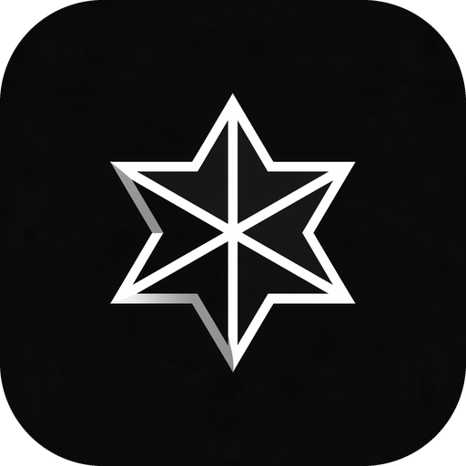

# Media kit and official channels

## Official accounts

| Channel | Address |
| --- | --- |
| Website | [usecanopic.com](https://usecanopic.com) |
| X | [@usecanopic](https://x.com/usecanopic) |
| Email | hello@usecanopic.com |

If a domain or account claims to be Canopic and is missing from this list, it does not belong to us. We publish contract addresses in two places only: these docs and the website.

## Writing the name

The correct form is **Canopic**, with an initial capital C followed by lower case letters. Avoid all caps when the name appears in body text.

## Voice

One voice runs through both the docs and the app: composed, technical and precise. In practice:

* sentences are brief and make plain statements;
* each figure carries its unit;
* costs appear as separate line items, never collapsed into one total;
* risks sit in the main text where readers will see them, never in footnotes;
* the tone stays level: no shouting, no exclamation marks, and no invented urgency.

The standard we hold ourselves to: should a doubtful auditor be able to read any sentence back to us and make us uncomfortable, that sentence gets rewritten until they cannot.

## Visual identity

### General approach

The visual language takes its cue from a precisely built control room: backgrounds close to black, panels in steel grey, and one source of light. Wording remains contemporary and technical. Feature names, buttons, error text and contract identifiers contain no mythology, legend or metaphor.

Think of the interface as dark-panelled hardware. Underneath everything lies a deep navy void, with sections taking turns between it and a base tone a shade lighter. Steel-coloured surfaces hold the cards, and hairline rules (never shadows) keep them apart. The logo uses no colour of its own, just white against near-black, which leaves ice blue as the only hue on screen. It is saved for links, focus states and the few items that genuinely need to stand out. The hero features genuine product UI, such as the swap ticket and live quotes, in place of illustration.

Pages favour big, confident headlines, generous whitespace and a relaxed pace from one section to the next. A section begins with a short monospace overline, followed by its headline and then its body. The hero carries a subtle starfield with a gentle ice glow, the sole decorative touch. When something needs to feel layered, we reach for outlines, a different surface tone or glow, and we avoid gradients and large drop shadows entirely.

### Logo mark

Our symbol is a star with six points, outlined heavily in white. Inside, three intersecting lines carve it into six dark facets, and the lower left edges carry a light grey bevel. It always appears on a rounded near-black tile, which keeps it consistent in every context. To make an app icon, crop the tile to a square and do nothing more. The shape remains readable even at favicon scale.

<figure><figcaption>Canopic mark shown on its tile</figcaption></figure>

Usage guidelines:

* Always present the mark on its near-black tile, except in the large hero version, where the star sits straight on the dark page. Do not change its colour or place it on a vivid background.
* Keep the tile free of borders, shadows and added glow, since the white outline already does the work.
* Give the tile a margin of clear space no smaller than 50% of its width.

### Colour palette

| Token | Value | Usage |
| --- | --- | --- |
| Void | `#05090f` | Background of the page |
| Base | `#08101a` | Sections that alternate with the void |
| Surface | `#0c1521` | Floating panels such as cards and popovers |
| Raised | `#121e2d` | A level above surface: elevated controls, zebra rows, loading skeletons |
| Steel | `#253750` | Stronger borders, plus the empty portion of sliders and progress bars |
| Foreground | `#f3f7fb` | Highest text level for headings and key copy; also fills the primary call-to-action button |
| Foreground 2 | `#b4c0cf` | Second text level, for body paragraphs and supporting copy |
| Foreground 3 | `#8592a3` | Third text level, for input labels, overlines and hints |
| Foreground 4 | `#76828f` | Faintest text level, reserved for timestamps and minor sub-labels |
| Ice | `#8eb6e8` | Our one accent: links, focus rings, highlighted words, the glowing dot |
| Ice bright | `#d3e6fc` | Strongest emphasis, such as text meant to look illuminated |
| Ice deep | `#4f6d97` | Subdued accent tone for borders and fills |
| Up | `#5fd0a5` | Rising prices, live indicators, success states |
| Down | `#f2836f` | Falling prices and errors |
| Warn | `#e9bd72` | Caution states; also the extended-hours and market-closed badges |
| Line | `rgb(150 182 226 / 0.1)` | Hairline rules separating rows and sections |
| Line strong | `rgb(150 182 226 / 0.18)` | More visible borders, for example around form inputs |

On the void background, each text colour clears WCAG AA contrast; primary and body copy go further and clear AAA.

Palette guidelines:

* The UI is dark-only. Light surfaces are not allowed, and neither are pure black or pure white backgrounds.
* Ice stands alone as the accent. Neon, purple, rainbow gradients and any additional accent hue are all excluded.
* Nothing on a screen outshines the lit white primary button. Shadows appear only on that button and on the single hero surface of each screen.
* Reserve up, down and warn for state, meaning values and status; never use them decoratively.

### Type

| Use | Font | Guidance |
| --- | --- | --- |
| Display | Space Grotesk in medium (500), with tight letter spacing | Sentence case throughout, for headlines, section titles and the wordmark |
| Body | Geist | 15 to 17px, in Foreground 2 |
| Overlines, labels, numbers | Geist Mono with tabular figures | Uppercase reserved for overlines of just a few words |

### Rounded corners

Corner radius grows with element size rather than following one universal value.

| Component | Radius |
| --- | --- |
| Tags | 6px |
| Inputs and compact controls | 10 to 12px |
| Buttons | Fully rounded pill |
| Cards | 20px |
| A screen's single hero surface | 24px |
| Big panels | 28 to 32px |
